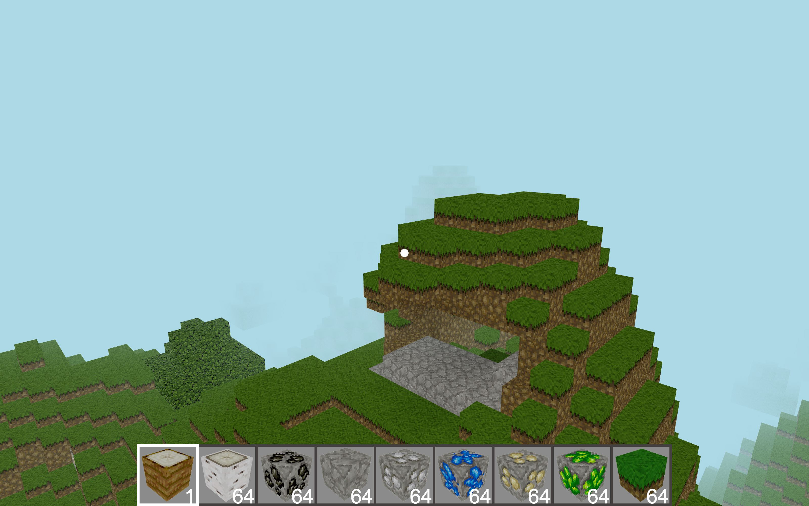
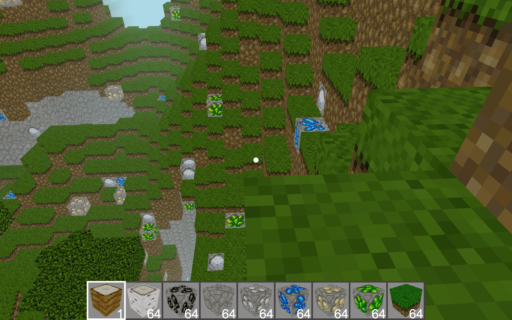
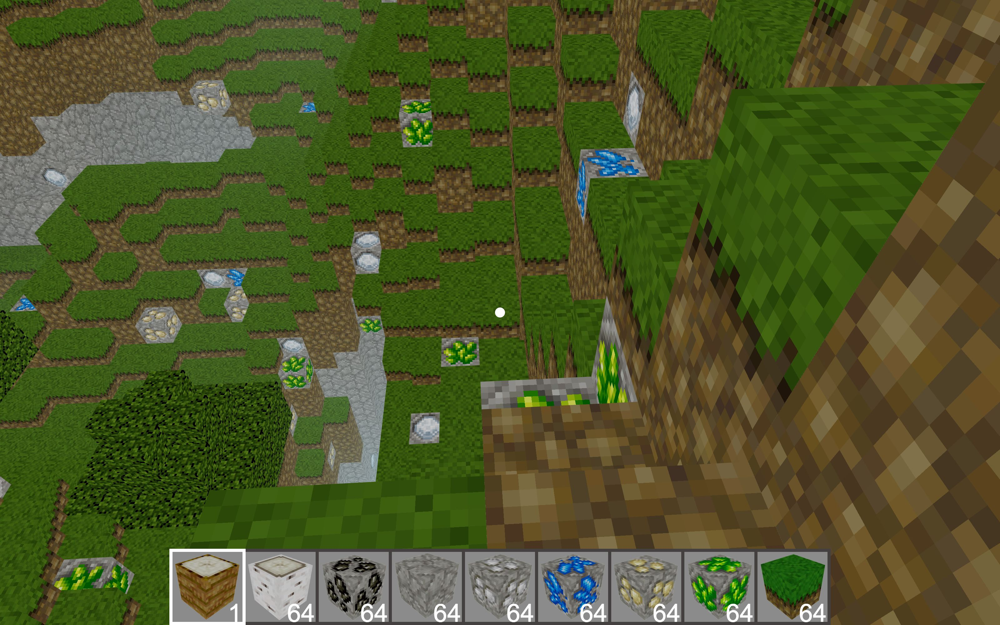

# Minecraft Clone

A voxel world that runs in a browser tab. Open [mc.trebeljahr.com](https://mc.trebeljahr.com), press Play, and walk, fly and dig through generated terrain. There is nothing to install and no account.

Rico Trebeljahr built it with three.js and TypeScript to learn 3D graphics in the browser. It is inspired by Minecraft and is not affiliated with Mojang or Microsoft.

The world streams in around you in chunks of 16×16×16 blocks. Web Workers generate the terrain, the sunlight and the meshes, so the main thread only has to draw.



| Before | After four left clicks |
| --- | --- |
|  |  |

## What you can do

- Walk or fly over terrain made from Perlin noise, with oak and birch trees.
- Break blocks with a left click. Each broken block goes into your inventory.
- Find coal, iron, gold, lapis, diamond and emerald ore in the stone.
- Pick a block from the hotbar with the mouse wheel, or press E and drag items between inventory slots.
- See the world lit by sunlight that spreads down from the sky.

Limits today: there is no saving, no crafting and no multiplayer. Right-click does not place a block yet. The game needs a keyboard and a mouse, so it does not work on phones.

## Controls

| Input | Action |
| --- | --- |
| Mouse | Look around |
| W A S D or arrow keys | Move |
| J | Turn gravity on or off. You start with gravity off, flying. |
| Space | Jump, or fly up while gravity is off |
| C | Fly down while gravity is off |
| Left click | Break the block under the crosshair |
| Mouse wheel | Choose a hotbar slot |
| E | Open or close the inventory |
| F | Go back to the spawn point |
| M / N | Raise or lower the top speed |
| Esc | Back to the menu |

## Run it locally

You need Node.js 24 and pnpm.

```sh
git clone https://github.com/trebeljahr/minecraft-clone.git
cd minecraft-clone
pnpm install
pnpm dev     # webpack dev server on http://localhost:3340
```

Other scripts:

```sh
pnpm build   # production bundle into public/dist
pnpm test    # Jest tests
pnpm check   # Biome format and lint
```

Every push to `main` builds the site and deploys `public/` to Cloudflare Workers ([`.github/workflows/deploy.yml`](.github/workflows/deploy.yml)).

## Project structure

```text
src/
├── main.ts               # sets up the scene, the menu and the game loop
├── Player.ts             # position, movement and gravity
├── controls.ts           # keyboard, mouse and menu buttons
├── chunkLogic/           # terrain data, sunlight and flood-fill light, meshing
├── workers/              # the Web Worker pool that runs chunkLogic off the main thread
├── streamChunks.ts       # loads and drops chunks as you move
├── inventory.ts          # hotbar and inventory
└── index.html            # page template
public/                   # static files and textures, the deploy root
scripts/                  # SEO file generator and marketing captures
```

## Tech stack

TypeScript, [three.js](https://threejs.org/), Web Workers through [threads](https://threads.js.org/), webpack, Biome and Jest. The noise function in `src/noise.ts` is adapted from [josephg/noisejs](https://github.com/josephg/noisejs) (ISC licence).

## License

The code is licensed under the [GNU Affero General Public License v3.0 or later](LICENSE). Images and art made by Rico Trebeljahr are © Rico Trebeljahr, all rights reserved. Third-party assets keep their own licences.

Support Rico's work: [ricos.site/donate](https://ricos.site/donate)
